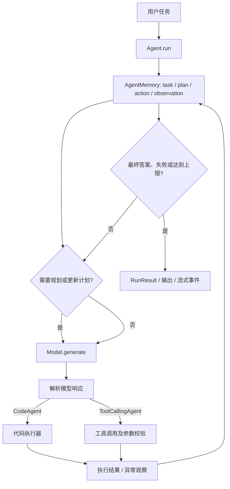

# smolagents Java 重实现技术方案

## 1. 目标与范围

本方案以仓库 `src/smolagents` 的公开能力和可观察行为为目标，设计一套 Java 实现路线。目标不是逐句翻译 Python，而是在 Java 中重建相同的核心概念、运行流程、扩展点和集成能力，并用行为测试验证兼容性。

范围包括 Agent 执行循环、模型适配、工具系统、代码执行器、记忆与回调、多模态数据、序列化、Hub 集成、MCP、遥测、CLI、浏览器 Agent 和可选 UI/远程执行器。Python 源码及其 Python API 不会因此被改写。

### 关键兼容决策：CodeAgent 执行什么语言

Python 版 `CodeAgent` 的模型输出是 **Python 代码**。Java 本身不能直接执行这些代码；把动作改为 Java 代码、JShell 或另一种表达式语言，会改变提示词、模型输出格式、工具调用语义和现有行为，不能视为透明移植。

建议将 Agent 编排、提示词、模型、工具、记忆及集成层用 Java 重写，同时将“执行模型生成的 Python”做成可替换后端：

1. 第一阶段采用独立 CPython 进程或容器作为兼容执行后端，以保留 Python 代码动作和常见 Python 工具生态。
2. 执行器通过 Java 接口隔离，后续可新增远程容器实现，或评估 Java 实现的受限 Python 子集解释器。
3. 不把 Java `eval`、JShell 或进程内脚本执行当成安全沙箱。若产品要求完全不依赖 Python 运行时，需另立兼容性决策并接受行为差异或较高解释器实现成本。

此方案推荐“Java 重写 Agent 库逻辑、执行后端保持语言兼容”，而不是承诺第一版即用纯 Java 执行任意 Python。

## 2. 现有工程的概念模型

工程核心是一个循环式 Agent：模型提出下一步动作，Agent 校验并执行动作，把执行结果追加为观察，再让模型继续，直到得到最终答案或达到步数上限。



这里的 `MultiStepAgent` 是共享运行机制的抽象基类；`CodeAgent` 和 `ToolCallingAgent` 通过不同的动作生成、解析和执行方式扩展它。Agent 的最终结果可以只是答案，也可以包含步骤、token 用量和计时信息。

## 3. Python 源码能力到 Java 领域的映射

以下按职责划分，而不是要求 Java 逐文件复刻 Python 包结构。括号内为当前 Python 源码中的主要参考文件。

| 领域 | Python 源码参考 | Java 设计职责 |
| --- | --- | --- |
| Agent 编排 | `agents.py` | `Agent`/`MultiStepAgent`、`CodeAgent`、`ToolCallingAgent`；运行循环、规划、重试/错误归类、最终答案校验、受管 Agent、流式输出和 `RunResult`。 |
| 模型与消息 | `models.py` | `Model` 接口、聊天消息/角色、工具调用、流式增量、结构化输出和 Provider 适配器。 |
| 工具抽象 | `tools.py`、`tool_validation.py` | `Tool` 元数据、输入/输出 schema、参数校验、工具注册和从 Java 方法创建工具的适配器。 |
| 内置工具 | `default_tools.py` | 内置工具实现及其注册表；依赖外部搜索、网页访问等库的工具应可选加载。 |
| 执行器 | `local_python_executor.py`、`remote_executors.py` | `CodeExecutor` 接口、本地 Python 兼容后端、Docker/E2B/Modal/Blaxel 等远程实现。 |
| 运行记忆 | `memory.py` | 各步骤类型、对话/执行历史、回调注册及按步骤类型触发的回调。 |
| 日志与指标 | `monitoring.py` | 日志级别、Agent 运行监视、token 用量和计时统计。 |
| 多模态类型 | `agent_types.py` | 图片/音频等 Agent 输入输出包装、模型输入转换和结果归一化。 |
| Hub 与持久化 | `serialization.py`、`agents.py` | Agent/Tool 序列化、配置及代码打包、Hub 下载/上传；需区分可移植配置与可执行自定义代码。 |
| MCP 集成 | `mcp_client.py` | MCP 客户端连接、远程工具发现及调用适配。 |
| CLI 与浏览器 | `cli.py`、`vision_web_browser.py` | 命令行启动 Agent 和视觉网页浏览 Agent。 |
| UI 与遥测 | `gradio_ui.py` 及遥测相关实现 | 可选的 Gradio 展示/交互、可配置的遥测导出；不得成为 core 的强制依赖。 |
| 通用设施 | `utils.py` | 解析、截断、命名校验、异常类型、模板和 UI 模板等跨领域基础设施。 |
| 提示词资源 | `prompts/` | 版本化的系统提示词、规划、工具调用及最终答案模板；资源打包需有测试。 |

模型提供方、远程执行服务和 UI 对应的是可选依赖能力，不应要求所有使用者安装全部集成。当前 Python 项目把许多集成做成 optional extras；Java 版也应保持按模块/依赖可选启用。

## 4. 建议的 Java 总体架构

建议采用 Maven 多模块，公共领域模型使用普通 Java 类型，集成层依赖 core 的接口而不反向依赖具体实现。

```text
smolagents-java/
├── smolagents-core/          # Agent、消息、工具、记忆、事件、异常及 SPI
├── smolagents-models/        # HTTP 共用实现与各模型 Provider 适配器
├── smolagents-executors/     # Python 兼容执行、Docker 及远程执行器
├── smolagents-tools/         # 内置工具与 MCP 适配
├── smolagents-serialization/ # 版本化 JSON、导入/导出与 Hub 适配
├── smolagents-cli/           # smolagent 命令行入口
└── smolagents-examples/      # 示例和端到端演示
```

Gradio 是 Python UI 技术，Java 版不应假定能直接复用；UI 可作为后续独立 Web 模块，以 HTTP/API 暴露运行事件。核心 API 不依赖特定 Web 框架。

建议基线为 Java 21 LTS、Maven 和 Jackson；当前实现的 POM 使用 Java 21、JUnit 6.1.3 与 Jackson。若部署环境要求较低版本，需作为兼容性变更重新评估。建议的核心接口如下，名称是设计草案：

```java
public interface Model {
    ChatMessage generate(List<ChatMessage> messages, GenerationOptions options);
    Flow.Publisher<ChatMessageDelta> stream(List<ChatMessage> messages, GenerationOptions options);
}

public interface Tool {
    ToolSpec spec();
    ToolResult execute(JsonNode arguments) throws ToolException;
}

public interface CodeExecutor {
    ExecutionResult execute(String code, ExecutionContext context)
        throws ExecutorException;
}

public interface Agent {
    RunResult run(AgentInput input, RunOptions options);
    Flow.Publisher<AgentEvent> runStream(AgentInput input, RunOptions options);
}
```

同步/异步与取消语义需要在 API 定稿前统一：底层网络/流式请求可支持取消；Agent 主 API 可先提供同步版本，并通过 `runStream` 暴露渐进事件，避免一开始让异步类型扩散到所有领域对象。

## 5. 核心领域对象与行为契约

### 5.1 消息与模型

- 定义稳定的 `MessageRole`、`ChatMessage`、`ToolCall` 和流式 delta 类型；保留多模态内容块，而不把所有消息强制压成字符串。
- `Model` 接口统一生成、流式生成、结构化输出和工具调用能力；适配器声明自己支持哪些能力，Agent 依据能力选择调用路径。
- Provider 适配按需实现：Hugging Face Inference、OpenAI 兼容端点、LiteLLM、Azure OpenAI、Bedrock，以及本地 Transformers/vLLM/MLX 等。HTTP 鉴权、重试、速率限制和 Provider 特有参数封装在适配器中。
- 流式 chunk 聚合、JSON 解析、角色映射和工具调用 ID 归并须有独立单元测试。

### 5.2 Agent 循环

- `MultiStepAgent` 管理公共生命周期：系统提示词、任务记忆、规划间隔、最大步数、回调、工具注册、受管 Agent、监控和最终结果。
- `CodeAgent` 把响应解析为代码块，提交给 `CodeExecutor`，再把 stdout、返回值或执行错误转成 observation。
- `ToolCallingAgent` 将模型返回的结构化工具调用逐个校验、执行，并将工具结果按关联 ID 回传模型。
- 对生成解析失败、工具参数错误、工具执行失败、模型请求失败和步数耗尽使用不同错误类型及策略，不用一个宽泛异常吞掉差异。
- `final_answer`、自定义最终答案校验、最大步数行为和 `return_full_result` 是需要行为兼容的边界。
- 同一个 Agent 实例并发运行是否允许，应明确为 API 契约。建议默认每个运行使用独立 `RunContext`/记忆实例，禁止共享可变步骤状态造成串话。

### 5.3 工具系统

- 工具元数据至少包含名称、描述、参数 schema 和输出类型；schema 是模型生成调用和 Java 端运行时校验的共同契约。
- Java 方法工具通过显式注解或 `ToolDefinition` 描述参数，不依赖 Python 式动态类型提示推断。用 Jackson JSON Schema 或内部受限 schema 表达必填字段、枚举、数组和对象。
- 工具输入校验失败必须给出模型可理解的错误观察，且不可绕过校验直接反射调用。
- 工具可以注册、组合、包装或映射到 MCP；外部集成工具按依赖模块单独启用。

### 5.4 记忆、事件及可观测性

- 把 `TaskStep`、`PlanningStep`、`ActionStep`、`FinalAnswerStep` 等统一为有类型的 `MemoryStep`，而不是以任意 Map 作为核心状态。
- `AgentMemory` 保存可序列化的运行历史；`RunContext` 保存单次运行的临时计数、状态和取消信号。
- `AgentEvent` 对外表达模型增量、规划、动作、工具结果、观察、错误和最终答案。回调按事件/步骤类型订阅；一个回调失败的隔离策略需定义清楚并可观测。
- `RunResult` 包含最终输出、状态、步骤、token 用量及计时，旧版兼容字段如 Python `messages` 应由兼容层处理，而不是污染新核心模型。

### 5.5 多模态、序列化与 Hub

- 图片/音频通过有类型的内容块和媒体引用表达，避免把二进制内容塞入普通 JSON 字符串；定义 MIME、来源和必要的生命周期管理。
- 序列化采用有版本号的 JSON schema，并为每种步骤、消息内容和工具调用提供稳定 discriminator；未知可选字段应有明确兼容策略。
- 支持的 Hub 操作应覆盖现有公开能力；上传/下载、repo 元数据和自定义 Agent/Tool 代码加载独立放入 Hub 适配模块。
- 反序列化外部包时默认不执行任意代码；自定义代码加载必须由调用者显式启用，并给出风险边界。

## 6. Python 执行与安全边界

代码 Agent 的执行结果会被模型再次观察，因而执行器是核心功能，不是普通工具。需要关注无限循环、资源耗尽、任意文件访问、网络访问、凭据读取和恶意依赖安装。

- 首选隔离容器/远程执行服务；限定 CPU、内存、执行时长、文件系统、网络及进程权限。
- 本机 CPython 子进程只是隔离程度较低的兼容后端，不能宣称为安全沙箱；必须支持超时终止、工作目录隔离和明确的环境变量策略。
- Python import allowlist 是能力限制的一部分，但不等于操作系统级安全边界。
- Docker、E2B、Modal、Blaxel 等适配器必须校验连接配置并对超时、断连、远端错误分类，不把失败伪装成成功的空输出。
- 对代码执行器建立拒绝访问密钥、父目录、系统进程和超额资源的负向测试；安全默认值应比“本地全权限执行”更严格，并允许调用者显式选择兼容模式。

## 7. 分阶段实施路线与当前状态

| 阶段 | 范围 | 完成标准 | 当前状态 |
| --- | --- | --- | --- |
| 0. 行为基线 | 固定 Python 源码版本；整理公开 API、提示词、正常/异常流程及测试用例；为难迁移行为建立 fixtures。 | 每项范围能力有来源文件、对应行为、优先级和验收用例；高优先级行为有可复现对照。 | **Partial**：CAP-01..17 清单和核心映射已登记；planning 部分有 Java 对照，完整 Python/Jinja 和 pytest 基线未跑齐。 |
| 1. Java Core | 消息/类型、工具 schema、异常、事件/回调、记忆、监控数据类型及 SPI。 | Java API 可编译；schema 验证、序列化和领域对象测试通过。 | **Partial**：领域模型和 SPI 已实现；CAP 矩阵仍列有 schema 默认值、迁移及行为差异。 |
| 2. Agent 最小闭环 | Mock Model、`ToolCallingAgent`、`CodeAgent` 编排、规划、最终答案、步数上限、RunResult 和流式事件。 | 使用确定性假模型跑通多步调用；核心行为与基线逐项对应。 | **Partial**：两种 Agent 和核心 flow tests 已实现；全量 Python prompt、managed-agent/Jinja、完整行为对照未完成。 |
| 3. 执行器与安全 | CPython 兼容后端、超时/取消、执行上下文；Docker 或远程后端。 | 代码输出、错误、状态持续性符合约定；隔离负向测试和可用后端 live test 通过。 | **Partial / blocked**：持久 CPython、Docker executor policy、Jupyter transport 已实现；没有 Docker/Podman/WSL daemon，原生云 provisioning 与真实隔离未验收。 |
| 4. 常用模型与工具 | OpenAI 兼容/HF/Ollama 模型适配、内置核心工具及 Provider 能力检测。 | HTTP mock 覆盖鉴权、错误、重试、流式和 tool-call 解析；无真实密钥可运行。 | **Partial**：Ollama native、HF Router、OpenAI-compatible 和多种工具有测试；HF 云端及剩余 Provider/edge cases 未验收。 |
| 5. 扩展能力 | 其他模型后端、MCP、managed agents、多模态、Hub 序列化/同步、遥测。 | 每项能力有清楚的可选依赖、failure contract 和适用集成测试。 | **Partial**：MCP、Hub 审阅/下载、serialization、monitoring、Whisper adapters 等已实现部分；原生远程 providers、真实 Whisper、完整媒体和 Gradio parity 未完成。 |
| 6. 应用入口 | CLI、视觉网页浏览能力和可选 Web UI。 | 命令参数/退出码可测试；浏览器与 UI 行为明确、安全且可选。 | **Partial**：CLI、Chrome CDP tool、loopback HTTP/SSE、多会话和可选本地持久化已实现；Python 专用视觉 Agent、完整 Gradio、多用户/多模态交互未完成。 |
| 7. 兼容验收 | 文档示例迁移、完整回归、兼容矩阵和发布策略。 | 逐项标记 Compatible/Partial/Unsupported，有环境记录、release checklist 和无过期状态的文档。 | **Partial**：根目录 `README.md` 和 `docs/01` 至 `docs/04` 已按当前源码、POM、测试报告校订并检查本地链接；CAP 行为 fixtures、Python 对照和最终 release review 未完成。 |

实施约束：后续优先修正文档中的代码/状态冲突，然后逐项做 Python 源码—Java 行为—测试对照。不要把存在 hook、adapter class 或 opt-in 测试入口等同于 provider/runtime 已验收；真实云服务、Docker、Whisper checkpoint 没有运行证据时继续标为 Pending/Blocked。

## 8. 测试与兼容验收

现有 Python 测试目录已经按 Agents、模型、工具、记忆、执行器、序列化、CLI、MCP、遥测、类型和浏览器等领域划分，可用作功能盘点线索。Java 侧不要求照搬 Python 测试代码，但应保留测试意图。

1. **Core 单元测试**：步骤状态迁移、最大步数、最终答案、参数 schema、计划间隔、回调顺序、异常归类。
2. **确定性 Agent 测试**：假模型按预设序列返回文本/工具调用/代码，断言动作、observation、记忆和结果结构。
3. **Golden/协议测试**：提示词渲染、消息 JSON、Provider 请求/响应、流式 delta、序列化文件版本。
4. **集成测试**：本地 mock HTTP 服务；CPython 后端使用可预测脚本；MCP 和远程执行服务用可替换测试端点。
5. **安全与健壮性测试**：畸形 JSON、未授权工具/导入、超时、取消、无效多模态数据、远端断连和资源上限。
6. **兼容矩阵**：只装 core、安装单个 Provider、未配置凭据、启用每类可选模块；CI 不依赖真实云密钥。
7. **示例验收**：将 Python README 中代表性 Agent 用法迁移成 Java 示例，作为 API 可用性测试。

兼容性不应只看“能连上模型”。关键可测量结果包括相同输入下的动作协议、步骤类型和次序、错误观察、是否继续执行、终止状态及最终结果结构。

## 9. 主要风险与待定事项

| 风险/事项 | 影响 | 建议 |
| --- | --- | --- |
| Python 代码执行语义与安全 | `CodeAgent` 兼容性的最大成本与风险。 | 先采用隔离后端接口并选定 CPython/容器策略；在承诺纯 Java 前评估解释器子集。 |
| Provider 行为差异 | tool call、流式和结构化输出格式并不完全一致。 | 用能力声明和适配器隔离差异，避免 Agent 核心依赖 Provider 特例。 |
| Python 动态工具定义 | 函数签名、类型提示和动态导入难以直接映射 Java。 | 采用显式 Java schema/注解；对动态自定义工具通过 SPI 或安全的序列化配置支持。 |
| 可选集成数量 | 全量移植可能使首个可用版本过大。 | 保留完整能力路线，逐阶段发布；每个集成标注依赖、平台要求和兼容级别。 |
| Hub 自定义代码 | 下载并执行代码具有供应链风险。 | 配置/数据与可执行代码分离；执行自定义代码需要显式授权。 |
| 同步/异步 API | 影响模型流、CLI、回调和取消的整体设计。 | Core 第一版定义统一事件流与取消模型；避免各模块自行选择互不兼容的异步抽象。 |
| Java 版本、构建与许可证策略 | 影响依赖选择、用户部署和分发。 | 当前 POM 固定 Java 21 + Maven；目标运行时已体现在 compiler release，发布前仍需确认分发方式并核实所有直接依赖及可选集成的许可证。 |

## 10. 当前方案的假设

- Java 版是独立实现，Python 包不被替换，也不要求保持 Python 代码 API 兼容。
- 以行为兼容为目标；对 Python 特有 UI、导入机制和任意自定义 Python 函数，提供 Java 原生替代接口或注明兼容边界。
- 第一版以 core 闭环和最常用模型/工具可用为优先，后续按第 7 节补齐全部集成。
- 当前实现以 Java 21/Maven、CPython 兼容执行器及单 Maven 模块为基线；改用纯 Java Python 子集解释器或降低 Java 基线属于需重新评估的兼容性变更。Provider、Gradio 等价 UI 和所有可选集成的完整交付范围仍以本文件待办与兼容矩阵为准。

## 11. 主要源码参考

- `src/smolagents/agents.py`
- `src/smolagents/models.py`
- `src/smolagents/tools.py`、`src/smolagents/tool_validation.py`、`src/smolagents/default_tools.py`
- `src/smolagents/local_python_executor.py`、`src/smolagents/remote_executors.py`
- `src/smolagents/memory.py`、`src/smolagents/monitoring.py`、`src/smolagents/agent_types.py`
- `src/smolagents/serialization.py`、`src/smolagents/mcp_client.py`、`src/smolagents/utils.py`
- `src/smolagents/prompts/`、`src/smolagents/cli.py`、`src/smolagents/vision_web_browser.py`
- `tests/` 下按 Agent、模型、工具、执行器、序列化及集成划分的测试文件

## 12. 当前剩余待办（持续维护清单）

> 这是当前项目的单一主 backlog。状态只根据可复现实现/测试证据更新；完成或新增任一项时，必须同时更新本表、`02-behavior-baseline.md` 和 `04-compatibility-matrix.md` 中的相关状态/证据。被环境阻塞的事项保留在表中，不用代码入口或 stub tests 代替通过验收。

| ID | 优先级 | 待办 | 状态 | 依赖/阻塞 | 完成条件 |
| --- | --- | --- | --- | --- | --- |
| DOC-01 | P0 | 校对根目录 `README.md` 与 `docs/01` 至 `docs/04` 的当前实现一致性 | Done | 无 | 已对照源码/POM/Surefire 报告检查 package、API 边界、版本、测试计数、live skip、限制及状态；5 份 Markdown 的本地链接均可解析。 |
| DOC-02 | P0 | 建立并维护本文件的单一剩余 backlog | Done | DOC-01 审计结论 | 稳定 ID、优先级、状态、依赖/阻塞和验收条件已登记；后续每项完成/新增均同步本文件与相应 CAP 文档。 |
| PAR-01 | P0 | 完成 CodeAgent/ToolCallingAgent planning prompt Python 对照 | Partial | pytest 当前未安装且 PyPI 下载失败；可用直接 Python probe 取证但不等同 pytest | 无/有 managed agents 的两类 Agent 初始及更新 planning prompt 均有完整 SHA-256 对照；Python YAML 中单花括号 `{remaining_steps}` 在比较时显式归一化，而 Java 保留真实预算。仍需覆盖 system-prompt 全量 YAML/Jinja（custom instructions、code tags 等）和完整运行上下文。 |
| PAR-02 | P0 | 完成 Agent 核心行为对照 fixtures | Partial | PAR-01 建立 fixtures 约定 | ManagedAgentTool 的 task/nullable additional_args 和 Python task/report wrapper 已有确定性验证；仍需比较 Java `includeRunSummary` 与 Python `<summary_of_work>` 语义，并覆盖 reset/续跑、max steps、final answer check、工具协议错误、stream/cancel、step/result/usage；差异写 CAP-01。 |
| PAR-03 | P1 | 比较 Model/消息/Provider 行为 | Pending | PAR-01 fixture 工具就绪 | 按 CAP-02 固化请求参数优先级、role/tool-call 转换、structured output、retry/stream error 与 provider capability 差异。 |
| PAR-04 | P1 | 比较 Tool schema/defaults 与 Python 工具描述 | Partial | PAR-01 fixture 工具就绪；Python pytest 当前不可用 | `ToolSpec` 已保存 outputType/可选 outputSchema；MethodToolAdapter 从 Java return type 映射输出类型，支持显式 JSON default，MCP outputSchema 映射为 structured schema；直接 Python probe 与 Java tests 对齐整数-as-number、nullable、缺失 nullable 和未知键拒绝。仍需按 CAP-03/04/16 对照函数签名 default 推导/coercion、scalar 单参数 API、Python type hints、ToolCollection 和 utility 行为。 |
| PAR-05 | P1 | 比较 AgentMemory/serialization 行为 | Partial | PAR-02 形成稳定 run fixtures | 已核对 Python summary mode 与 Java full/summary 消息 API 的 system prompt 处理、内部 tool roles 和 error/observation 结构；已避免工具失败同时作为 observation 与独立 user retry 提示重复进入上下文。仍需补无密钥 cross-language fixtures/tests，并按 CAP-07/10 对照 CodeAgent/protocol error mapping、旧快照导入、跨语言安全 JSON 与同系统提示词恢复。 |
| EXE-01 | P1 | DockerPythonCodeExecutor 真实隔离和 Ollama CodeAgent 验收 | Blocked | 当前机器没有 Docker/Podman/WSL daemon | 在 daemon 可用的隔离环境验证只读文件系统、无网络、非 root、资源/超时和清理；之后运行低风险 OLL-02。 |
| REM-01 | P1 | E2B 原生 Code Interpreter executor | Pending | 官方目前以 Python/JS SDK 为主；需选定依赖/桥接方案和真实 E2B 凭据 | 实现沙箱 create/run_code/cancel/cleanup、变量/final_answer/错误映射和明确工具桥接边界；mock 与 opt-in 云测试通过。 |
| REM-02 | P1 | Modal 和 Blaxel sandbox lifecycle adapters | Pending | 无官方 Java SDK；Modal 可用受支持 SDK bridge/明确 HTTP API，Blaxel REST contract 需核验 | 创建/配置运行 Jupyter gateway、认证/端口 tunnel、连接/超时/清理闭环有 mock 与 opt-in live 证据。 |
| WHI-01 | P1 | Transformers Whisper 实际模型、音频前处理验收 | Blocked | 本机缺 `accelerate`、`soundfile` 和缓存 checkpoint；网络下载未授权/不可用 | 在显式授权环境运行 `TransformersWhisperToolIntegrationTest`，覆盖语音、采样率、长音频、语言和 worker cleanup；更新 CAP-04/09。 |
| VIS-01 | P1 | Python 视觉 Agent / browser tool 行为对照 | Pending | 当前仅 Java CDP browser tool + CLI wiring | 对照 Python browser controls、弹窗、页面读取/返回和视觉模型入口；可自动化项有 Chrome/loopback 测试。 |
| UI-01 | P1 | 完成 Web/Gradio 等价交互范围 | Partial | 当前 loopback UI 有每会话事件/AgentMemory 持久化，但没有用户身份/租户隔离；持久化不加密 | 对照 CAP-15 补图片/音频上传、模型/工具配置及用户/会话授权；若 Java 选用非 Gradio Web UI，明确替代范围并完成界面交互测试。 |
| EXT-01 | P1 | 收敛其它部分兼容的可选 CAP | Partial | 特定协议/API 和 optional dependency 需分别核验 | 补 MCP subscriptions/sampling/elicitation 决策、Hub 审阅/批准 UI、telemetry exporter、optional-classpath/导入兼容及 CAP-08/11/12/17 测试。 |
| REL-01 | P0 | 完成 CAP-01..17 兼容矩阵与发行验收 | Pending | 所有适用 P0/P1/P2 条目有结论；DOC-01/`PAR-*` | 全量 Java/Javadoc/可用的 Python tests 通过；每项有证据/环境/限制；所有未实现功能明确 Partial/Unsupported，并完成 release checklist。 |

### 12.1 验证基线和环境阻塞

- 当前执行模式：用户要求暂不修改源码和测试代码，仅维护文档及剩余待办，直至用户明确恢复代码实施。Java 工程完整源码/测试/文档已推送至 `fengzhenbing/smolagents-java` 的 `main`，初始代码提交为 `d3b1fc1b4437871b0b6d2f88a48d29ab94d36d9f`；`target/` 构建产物与 `.idea/` 本机 IDE 配置未纳入仓库。此推送不代表整体重实现已完成。
- 最近一次完整 Maven/Javadoc 验证：`.\mvnw.cmd test javadoc:javadoc`，212 tests、0 failures/errors、7 opt-in skips；后续代码修改须重新运行并同步计数（2026-10-25 在未改动 Java 源码的前提下复跑确认同一计数）。
- 构建工具链要求：Maven 必须运行在 JDK 21 及以上。本机 `PATH` 上的 `java` 是 1.8（`C:\Program Files (x86)\Common Files\Oracle\Java\java8path`），`JAVA_HOME` 原本为空，导致 `.\mvnw.cmd test` 在 surefire fork 阶段崩溃并在 `target/surefire-reports/` 留下 287 个 `.dumpstream`；已在用户级环境变量把 `JAVA_HOME` 指向 `C:\Users\Administrator\.jdks\liberica-full-21.0.12.1`（残留文件已清理，`PATH` 上的 1.8 属机器级配置未改动，以 `JAVA_HOME` 为准）。POM 同时加入 `maven-enforcer-plugin` 3.5.0（`validate` 阶段 `requireJavaVersion [21,)`、`requireMavenVersion [3.9,)`），旧 JDK 现在会在 `validate` 立即失败并给出可读提示，不再退化为 fork 崩溃。`.\mvnw.cmd -v` 可自查实际 JDK。
- 文档复核：逐项核对根目录 `README.md` 与 `docs/01` 至 `docs/04` 和当前源码/POM/Surefire XML，并验证 5 份 Markdown 的本地链接；`ToolExecutionContext` logger 误述、ToolSpec 输出元数据和 planning prompt 差异已按当前实现修订。文档修订不会替代后续 Python 行为对照。
- Chrome/CDP 视觉浏览器和 Web UI 会话/任务 smoke 曾显式通过；本机 `gemma4:26b` Ollama smoke/tool calling/ToolCallingAgent 3/3 曾显式通过。
- 本机 Python（`D:\soft\python314\python.exe`，3.14）中可导入 `smolagents` 1.26.0、`jinja2` 3.1.6、`yaml`、`huggingface_hub`；`pip` 26.2.1 可用，`python -m pip install --dry-run pytest` 能解析出 `pytest-9.1.1`（PyPI 可达），但 `pytest` 仍未安装，早期记录的 `uv` 安装被网络拒绝已不复现。可继续使用直接 Python 探针，但必须标注其不是 pytest suite。
- Docker/Podman/WSL 不可用（本机未安装 `docker`/`podman` CLI，不是仅 daemon 停止）；本机 Whisper 缺少 `accelerate`/`soundfile` 且没有模型 checkpoint；远端 E2B/Modal/Blaxel credentials 未提供。任何相关事项未能在真实环境执行时都保留 Blocked/Pending。
