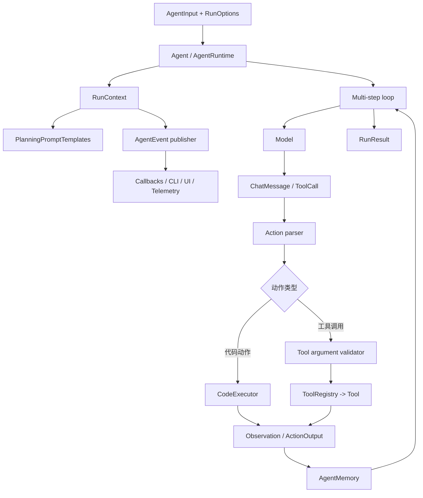
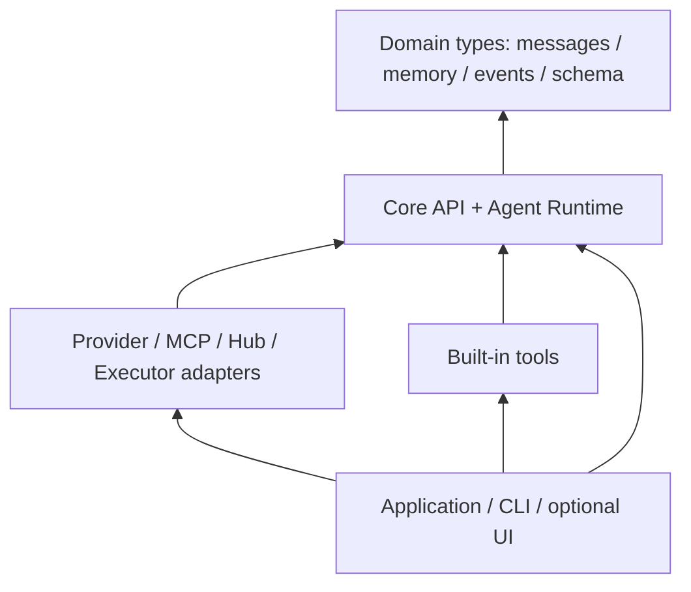

# Java 总体架构与模块划分

> 状态：架构设计及现状对照；目标结构不代表所有能力均已实现。当前功能状态以 [04 兼容矩阵](04-compatibility-matrix.md) 为准。  
> 对应总体方案：[Java 重实现技术方案](../README.md)  
> 参考源码：`D:\code\smolagents\src\smolagents`

## 1. 本文目的

本文把总体重实现方案落到 Java 的组件职责、依赖边界和包结构上，并区分当前实现与后续目标。读者可以用它回答三个问题：

1. Python 工程有哪些相对独立的职责，Java 中分别由谁负责？
2. Agent 执行期间，模型、工具、记忆和代码执行器如何协作？
3. 当前单 Maven 模块怎样保持结构清楚，以及何时有充分理由拆分发布模块？

本文描述架构边界而非整体完成声明。当前已实现范围、证据与未完成差异列在 `04-compatibility-matrix.md`；本文其余设计建议需要与该矩阵配合理解。

## 2. 架构目标与约束

### 2.1 目标

- 用 Java 实现可独立使用的 Agent/ToolCalling 核心；只有选择 CodeAgent、本地 Transformers 工具或其他 Python runtime 集成时才需配置 Python 及相应包。
- 保留 smolagents 的重要行为：多步循环、CodeAgent/ToolCallingAgent 两种动作模式、规划、工具验证、步骤记忆、流式事件和完整运行结果。
- 用接口隔离模型 Provider、工具来源、代码执行环境和外部服务。
- 可逐步加入多模态、MCP、Hub、CLI、远程执行器和遥测，不让可选集成反向成为核心依赖。
- 通过行为测试比较 Python 版与 Java 版，而不是要求 Java 源码逐文件仿照 Python。

### 2.2 约束

- Python `CodeAgent` 的动作是 Python 代码。Java 核心不能将其悄然改成 Java/JS 代码；Python 执行器必须是明确的 SPI 和独立信任边界。
- `ToolCallingAgent` 的模型输出是结构化工具调用；工具名称、参数 schema 和调用 ID 必须在模型适配及执行之间保持一致。
- Agent 运行状态会累积步骤、观察、媒体数据和 token 用量。一次运行的状态必须隔离，避免并发运行串线。
- 模型 Provider、远程执行平台和内置工具有不同可选依赖。Core 不得直接依赖某个云厂商 SDK。
- 仓库当前是 Java 21 的单 Maven 项目，已包含 Agent、Model、Tool、Executor、记忆、CLI、Hub、MCP 和 loopback Web 等实现。云端原生 executor、完整 Gradio 等价 UI 和全量 Python 行为兼容仍未完成。

## 3. 系统上下文

smolagents-java 位于“应用”和外部能力之间：应用创建 Agent 并提交任务；Agent 用 Model 生成下一步动作，用 Tool 或 CodeExecutor 执行动作，然后将 observation 放入运行记忆中供下一轮推理。

```mermaid
flowchart LR
    APP[Java 应用 / CLI] --> API[smolagents-java API]
    API --> AGENT[Agent Runtime]
    AGENT --> MODEL[Model SPI]
    AGENT --> REG[Tool Registry]
    AGENT --> EXEC[CodeExecutor SPI]
    AGENT --> MEM[Run Memory / Events]
    MODEL --> PROVIDER[模型服务 / 本地模型]
    REG --> TOOLS[内置工具 / 用户工具 / MCP 工具]
    EXEC --> PY[CPython process (not isolated by default)]
    EXEC --> REMOTE[Optional Docker / remote executor]
    TOOLS --> EXT[搜索 / 网页 / 其他外部服务]
    MEM --> OBS[日志 / 指标 / UI 订阅者]
```

图中是逻辑关系，不代表每种部署都必须同时有所有外部系统。默认 CPython process 以当前 OS 用户权限运行，并非隔离沙箱；Docker 与远程 executor 是可选后端，真实隔离尚待 live 验收。ToolCallingAgent 可以不配置 CodeExecutor；若只用本地 MockModel 和自定义 Tool，应用也不需要云 Provider。

## 4. 逻辑组件与依赖方向

### 4.1 运行时组件



Java 设计中建议让 `AgentRuntime` 负责一轮运行的控制流程，策略对象负责不同动作协议：

- **Agent 公共策略**：组装系统提示词、规划时机、生成、解析结果、更新步骤、检查终止条件。
- **Code 策略**：提取/校验代码动作、调用 `CodeExecutor`、处理 stdout/返回值/执行错误。
- **Tool-calling 策略**：读取模型工具调用、解析 JSON 参数、校验 schema、路由 Tool、格式化工具结果。
- **运行上下文**：保存当前任务、运行 ID、单次运行的状态、取消标记和运行配置。Agent 配置本身与单次运行上下文分开。

当前实现由 `PlanningPromptTemplates` 生成规划文本；CodeAgent 和 ToolCallingAgent 使用分开的 Python-shaped 默认模板及工具描述格式。它不是通用 `PromptRenderer`，也不执行完整 Python YAML/Jinja 条件块；自定义模板变量限于 `task`、`tools` 和 `remaining_steps`。

Python 版用 `MultiStepAgent` 共享基础循环，并由 `CodeAgent`、`ToolCallingAgent` 特化动作行为。Java 可用抽象类或组合策略实现相同职责；不要求照搬 Python 的继承结构。推荐优先使用组合式 `ActionStrategy`，以降低单个基类承担模型、记忆、工具、渲染、执行等所有职责的风险。

### 4.2 依赖规则

依赖箭头表示“编译期依赖”方向；实现类可以在应用装配时注入到接口，不应让 core 反向导入集成包。



具体规则：

1. 领域类型不依赖模型 SDK、MCP SDK、Docker SDK、Gradio 或 CLI 框架。
2. Core 依赖领域接口；Provider、MCP 和 executor adapter 实现这些接口。
3. Tool 只依赖工具契约和它所需的具体外部能力；Agent 通过 `ToolRegistry`/`Tool` 契约调用，不直接引用某个内置工具类。
4. UI、CLI、Hub、遥测通过事件/API 使用 Agent；它们不得成为 Agent 执行循环的组成依赖。
5. MCP 远程工具应适配为普通 Tool；MCP 生命周期（连接、断开、资源释放）由 MCP adapter 管理。
6. 任何 adapter 不得通过静态全局变量写入 Agent 的单次运行状态。

## 5. Java 包结构与 Maven 模块策略

### 5.1 当前实现：一个 Maven 模块，按职责分包

当前 `pom.xml` 只有一个 `smolagents-java` Maven 项目，编译目标为 Java 21。`org.fzb.Main` 已接入 `SmolagentsCli`，不是 IDE 示例骨架。当前实际 package 结构如下：

```text
D:\code\smolagents-java\src\main\java\org\fzb\
├── Main.java
└── smolagents\
    ├── adapters\              # huggingface, ollama, openai; 共用 retry helper
    ├── agent\                 # AgentRuntime, strategies, Agents, planning templates
    ├── cli\
    ├── core\                  # AgentInput, RunOptions, AgentValue, exceptions
    ├── event\
    ├── executor\              # CPython process, Docker executor, remote\
    ├── hub\
    ├── memory\
    ├── model\                 # Model SPI, ChatMessage, ContentPart
    ├── monitoring\
    ├── serialization\
    ├── server\                # loopback HTTP/SSE, AgentSessionFactory, Web UI
    ├── tool\                  # built-ins, MCP, browser, speech/Whisper
    └── util\
```

`src\main\resources` 中包含 CPython 与 Whisper worker；测试和 Python worker fixtures 位于 `src\test`。当前没有单独的 `api/`、`prompt/` 或 `media/` package：公共配置/异常在 `core`，消息和媒体在 `model`，规划模板在 `agent`。本树只展示仓库现有 package；未来 Maven 子模块仍是候选设计。

Maven 包结构示意如下：

```text
smolagents-java/
├── pom.xml
├── docs/
├── src/main/java/org/fzb/smolagents/...
├── src/main/resources/org/fzb/smolagents/{executor,tool}/*worker.py
└── src/test/java/org/fzb/smolagents/...
```

### 5.2 后续按需拆分 Maven 子模块

总体方案中的多模块清单是目标候选，不需要在第一阶段全部落成 Maven 子项目。优先满足逻辑隔离，再用真实依赖和发布场景确定物理边界。

触发拆分的信号：

- 某集成引入体积大、版本冲突多或平台受限的依赖，core 使用者不应被迫传递安装它。
- 集成要独立版本、独立发布、独立维护或单独测试。
- 包边界已稳定，且拆分能在构建时阻止循环依赖，而不只是增加 POM 数量。
- 插件需要独立分发或通过 `ServiceLoader` 发现。

建议优先拆分候选：

| Maven 子模块候选 | 内容 | 对 core 的依赖 |
| --- | --- | --- |
| `smolagents-core` | API、Agent runtime、领域对象、记忆、事件、提示词基础设施 | 无集成依赖 |
| `smolagents-models-openai` / `smolagents-models-hf` | 模型 Provider 适配器 | 依赖 core |
| `smolagents-executor-python` / `smolagents-executor-docker` | Python 兼容和容器执行器 | 依赖 core |
| `smolagents-tools` / `smolagents-mcp` | 内置工具和 MCP adapter | 依赖 core |
| `smolagents-cli` | CLI 和默认装配 | 依赖 core 与选定 adapter |
| `smolagents-hub` / `smolagents-telemetry` | Hub 与遥测集成 | 依赖 core |

**拆分原则：** 子模块依赖方向始终从 adapter 指向 core；core 不依赖任何 adapter。不要为每个 Python 文件创建一个 Maven 模块。

## 6. 核心 API 边界

以下为当前责任边界与核心 API 概念；精确字段/行为以 Java 源码和 `03-core-domain-and-api.md` 为准。

| 契约 | 归属 | 必须负责 | 不负责 |
| --- | --- | --- | --- |
| `Agent` / `AgentRuntime` | `agent` + `core` | 接收输入，创建运行上下文，驱动动作循环，产出结果/事件 | Provider HTTP 细节、MCP 协议细节 |
| `Model` | `model` | 基于消息及生成选项产生响应或流式增量；说明 tool-call/多模态能力 | 工具实际执行和 Agent 记忆 |
| `Tool` / `ToolSpec` | `tool` | 描述可调用功能、输入 schema、Python 兼容输出类型/可选输出 schema 和执行行为 | 任意 Provider 的请求格式 |
| `ToolRegistry` | `tool` | 工具及受管 Agent 的名称解析、冲突检查、受控分发 | 外部服务连接生命周期 |
| `CodeExecutor` | `executor` | 接收代码和受限上下文，返回标准化结果；支持超时/取消契约 | 决定 Agent 是否继续规划 |
| `AgentMemory` | `memory` | 保存带类型的步骤并转换成模型上下文/完整结果 | 长期用户画像或外置向量数据库 |
| `AgentEvent` | `event` | 表达运行进度、动作、观察、错误和终止 | 将事件绑定到特定 UI/遥测库 |
| `PlanningPromptTemplates` | `agent` | 渲染当前支持的规划模板和白名单变量 | 通用 YAML/Jinja 或任意模板逻辑（尚未实现） |

适配器创建与选择放在应用装配层：应用可以显式 `new OpenAIModel(...)`，也可以由 CLI 根据参数创建。Core 不应在初始化期间隐式读取某个供应商凭据或联网。

### 6.1 一次运行的数据流

1. 调用方提供任务、多模态输入、additional arguments 和运行选项。
2. Agent 建立 `RunContext`；按 reset/continuation 约定初始化或延续记忆。
3. 当前规划模板实现从固定模板及任务/可用工具生成 planning messages；系统/动作 prompt 由 Agent 配置提供。
4. Model 返回 assistant message、tool call 或流式 delta。
5. Agent strategy 将响应解析成强类型动作；工具参数在实际调用前校验。
6. Tool 或 CodeExecutor 执行动作；结果、异常、用量和时长转换为可记录的步骤与 observation。
7. AgentMemory 保存步骤；AgentEvent 发布运行事件；直到最终答案、失败或达到步数上限。
8. 调用方取得简洁答案或 `RunResult`；流式调用方在运行期间消费事件。

每一步产生的领域状态必须可在没有网络和真实模型的单元测试中构造。运行 ID 与错误分类也应出现在事件或结果中，便于定位单次运行。

### 6.2 CodeAgent 和 Python 执行器边界

`CodeAgent` 使用 Python 提示词和代码动作协议。建议定义与语言无关的 Java `CodeExecutor` SPI，而第一种兼容实现通过受控 IPC 调用 Python Runtime：

```text
AgentRuntime
  -> CodeActionStrategy
  -> CodeExecutor.execute(code, ExecutionContext)
  -> Python process / remote sandbox
  <- ExecutionResult(stdout, result, error, duration, metadata)
```

本地 `PythonProcessCodeExecutor` 已使用持久 JSON Lines worker 区分标准输出、结构化返回、异常、行号、超时和取消；工具/变量通过 JSON 安全值桥接，不使用 pickle。执行器实现不得宣称“allowlist 等同于操作系统沙箱”。Docker 隔离参数已有策略测试，但当前环境缺 Docker/Podman/WSL，真实隔离边界尚未 live 验收。

若项目未来决定“只允许纯 Java，不安装或运行 Python”，那是产品行为决策：需选择可支持的 Python 子集，测量与 Python 版的兼容差异，并更新 CodeAgent 的兼容级别，而不是直接把实现替换为 JShell。

## 7. 扩展集成与配置边界

### 7.1 模型适配

- 共用消息领域类型；每个 adapter 负责供应商特有请求字段、鉴权、错误解析、限流/重试和流式 chunk 聚合。
- 通过 capability 描述是否支持 tool calling、structured outputs、streaming、多模态及 stop 参数；缺少能力时显式报错或走明确定义的降级策略。
- Provider 类型注册不等同于公共领域类型；增加一个 Provider 不得改动 Agent 核心循环。
- 当前已实现 Ollama native、Hugging Face Inference Router 和 OpenAI-compatible adapters；本机 Ollama/Gemma 已做 live 测试，HF 云端和其它 Provider 尚未验收。添加 Provider 应补能力矩阵、mock 协议测试和可选依赖/failure contract。

### 7.2 Tool 与 MCP

- 用户 Java 方法/类通过显式 ToolSpec 注册；不依赖 Python 的运行时类型提示或自动任意反射。
- MCP adapter 把远端工具 schema 和执行映射到本地 Tool 契约，并拥有 connect/close 生命周期。
- 工具名冲突、无效参数和工具异常都要保留可追溯错误信息；对模型返回的错误观察不得泄露密钥或内部栈信息。
- 外部工具按 adapter 启用，core 不暗中构造云搜索客户端。

### 7.3 序列化、Hub、日志与密钥

- JSON 序列化只负责稳定领域配置/运行结果；使用 schema version 和 type discriminator，媒体采用媒体引用或显式编码策略。
- 不序列化 Provider secret、环境变量、运行时 socket、进程句柄或非安全 Java 对象图。
- Hub 访问和远端上传/下载处于独立 adapter；外部包中的可执行代码不应在普通反序列化时自动执行。
- 凭据由应用注入或从运行环境的 secret provider 读取；不得写入 prompt、普通日志、序列化结果或异常文本。
- `AgentEvent` 可接日志/指标/遥测订阅者；遥测默认最小化并可禁用，失败需显式可观测但不能破坏 Agent 主流程（隔离策略待确认）。

## 8. Python 源码职责映射

文件映射用于定位行为和测试，不是 Java 文件对照复制表。下表第二列记录当前主要 Java package；设计职责并不意味着该功能已达到 Python 完整兼容。

| Python 源码 | 当前 Java package | 设计说明 / 未迁移边界 |
| --- | --- | --- |
| `agents.py` | `agent`、`core`、`event` | AgentRuntime、两种动作策略、规划、校验、memory 和 stream 已实现；完整 Python 模板与全量行为仍待对照。 |
| `models.py` | `model`、`adapters.*` | ChatMessage、ToolCall、stream delta 和 Ollama/OpenAI-compatible/HF adapters；其它 Provider 及 edge cases 未全覆盖。 |
| `tools.py`、`tool_validation.py` | `tool` | ToolSpec 输入/输出 schema metadata、schema 校验、registry、Java method adapter 已实现；Python type hints/default coercion 并非完全等价。 |
| `default_tools.py` | `tool` | final answer、user input、搜索、网页、Wikipedia、transcriber 和 browser 工具各有实现；工具清单/返回结构仍有差异。 |
| `local_python_executor.py` | `executor` | 持久 CPython process worker 已实现，不是 Python AST 子集解释器，也不是安全沙箱。 |
| `remote_executors.py` | `executor.remote` | 标准 Jupyter gateway transport 和 provider hooks 已实现；原生 E2B/Modal/Blaxel 创建与鉴权尚未完成。 |
| `memory.py` | `memory`、`event` | 步骤模型、上下文映射、版本化 JSON codec、回调和事件已实现；跨语言 schema migration 与精确 parity 待补。 |
| `monitoring.py` | `monitoring` | AgentLogger、AgentMonitor 已实现；Rich UI 和 telemetry exporter 未实现。 |
| `agent_types.py` | `model.ContentPart`、`core.AgentValue` | Text/Image/Audio/JSON 内容片段已实现；Python 类型包装、归一化和 Provider matrix 仍部分兼容。 |
| `serialization.py` | `serialization`、`memory` | allowlist JSON 序列化和 AgentMemory codec 已实现；pickle/所有 Python 专有对象均不兼容。 |
| `mcp_client.py` | `tool.MCPClient` | stdio、Streamable HTTP 与 legacy SSE 基础发现/调用已实现；subscriptions、sampling 和 elicitation 未实现。 |
| `cli.py` | `cli`、`org.fzb.Main` | Ollama/HF/OpenAI-compatible、工具选择、浏览器/Whisper 选项、stream 和退出码已实现；完整 Python CLI 未迁移。 |
| `vision_web_browser.py` | `tool.VisualBrowserTool`、`cli` | CDP browser actions 和 CLI 配置有实现；Python 专用视觉 Agent/行为仍待对照。 |
| `gradio_ui.py` | `server.AgentHttpServer` | 有 loopback JSON/SSE Web UI、多会话及可选持久化；不是 Gradio 等价 UI。 |
| `utils.py`、`_function_type_hints_utils.py` | `util`、`tool` | AgentUtils 和显式 Java ToolDefinition/annotations 实现了安全子集；Python AST/type-hint 行为不完全移植。 |
| `prompts/*.yaml` | `agent.PlanningPromptTemplates` | planning defaults/tool renderers 为 Python-shaped Java 模板；当前模板内嵌 Java，完整 YAML/Jinja 条件块仍未迁移。 |

参考 Python 项目的 `pyproject.toml` 可看到模型、MCP、Docker、UI、遥测、工具包和媒体依赖被划为可选 extras。Java 当前是单 Maven module，虽然部分功能可在运行时不配置/不加载，但尚无独立 artifact/profile 的 classpath 隔离测试；这仍是 CAP-17 待办。

## 9. 渐进实现顺序与架构验收

架构顺序是先稳定边界，再扩展 adapter；每一阶段都应可编译并有自动化测试。

| 顺序 | 能力切片 | 对架构的验证 |
| --- | --- | --- |
| 1 | 领域类型、异常、配置、Model/Tool/CodeExecutor 接口 | API 可独立编译；领域对象不引用 Provider SDK。 |
| 2 | MockModel + ToolCallingAgent + ToolRegistry + Memory/Event | 不连真实网络可验证一步/多步调用、工具参数错误和最终结果。 |
| 3 | CodeAgent strategy + Python IPC executor | 验证代码输出、异常、超时、取消、变量传递及安全默认策略。 |
| 4 | 一个模型 adapter + 提示词资源 + 流式调用 | 以 HTTP mock 测试鉴权、响应解析、tool-call 和 stream 聚合。 |
| 5 | 内置工具、MCP、managed agents、多模态、序列化 | 插件不污染 core；各 schema/生命周期均有独立测试。 |
| 6 | Hub、CLI、遥测、远程 executor、可选 UI | 面向真实配置完成集成测试；依赖与凭据边界清晰。 |
| 7 | Maven 子模块评估 | 对照真实依赖、发布和平台需求决定拆分；无循环依赖。 |

架构验收标准：

- `agent` 只面向 Model、ToolRegistry、CodeExecutor、记忆及事件等抽象，不导入具体 Provider/云厂商 SDK。
- 在没有网络、凭据和外部服务时，可通过 Fake/Mock 实现验证 Agent 核心流程。
- 不启用的可选集成不会因静态初始化而导致 core API 无法加载。
- 并发的两个 Agent run 使用隔离的 memory、计时、取消信号和事件上下文。
- CodeAgent 的 Python 运行环境清楚标注兼容级别和安全边界；超时和执行失败不是成功形状的空结果。
- 每个公共响应/序列化类型有稳定 schema 和兼容策略；密钥不出现在结果和日志。
- Mermaid 图、包树和源码映射一致，实施过程中同步更新本文及总体方案。

Python 仓库 `tests/` 的 Agents、models、tools、memory、executor、serialization、MCP、CLI、monitoring 和多模态相关测试是后续行为基线的重要索引。

## 10. 未完成决策与后续评估

以下选择在进入对应模块详细设计前确认，不影响本文先确定逻辑依赖边界：

| 决策/工作项 | 当前已知状态与边界 | 复核/验收时机 |
| --- | --- | --- |
| Maven 是否拆多模块 | 当前维持单模块；等可选依赖与发布边界稳定后再评估，不将拆分本身作为兼容目标 | 发布规划阶段 |
| Java 最低版本 | 当前 POM 固定 compiler release 21 | 依赖/发布升级时 |
| CodeAgent 安全后端 | CPython 和 Docker executor 都有实现；本机没有 Docker/Podman/WSL daemon，运行时隔离未验证。CPython 不可作为不可信代码沙箱 | Docker-capable 环境到位后 |
| 远程执行 Provider | E2B/Modal/Blaxel 目前只有通用 Jupyter transport 与显式生命周期 hooks；无内置原生 sandbox SDK lifecycle | Provider-specific adapter 验收时 |
| 模型 Provider | Ollama native、Hugging Face Inference Router、OpenAI-compatible 已实现；HF 云端与更多 Provider 尚未实测 | Provider 兼容验收时 |
| UI 目标 | 已有 loopback Web/SSE UI 和可选会话/记忆持久化；不是 Gradio 等价实现，没有用户/租户身份、多模态上传或模型/工具管理 | UI 范围验收时 |
| Python prompt/行为兼容 | 默认规划 YAML 在有/无 managed agents 的固定工具样例中已有完整文本 hash 对照；managed-agent task/report 默认模板已移植；system-prompt 全量 YAML/Jinja 和全量 CAP fixtures 未完成，pytest 受环境阻塞 | 按 `02`/`04` backlog 推进时 |
| Whisper Transformers live | worker、CLI 和 opt-in 真实模型测试入口已实现；运行需额外包、语音样本及本地缓存或显式下载授权 | 可用模型环境时 |
| Hub 自定义代码 | Hub 文件可下载、审阅和受控保存；下载的代码不执行，完整批准/安全执行界面未实现 | Hub 扩展阶段 |

## 11. 参考

- 总体方案：[根目录 README](../README.md)
- Java 项目现状：`D:\code\smolagents-java\pom.xml`、`D:\code\smolagents-java\src\main\java\org\fzb\Main.java`
- Python 源码：`D:\code\smolagents\src\smolagents`
- Python optional dependencies：`D:\code\smolagents\pyproject.toml`
- Python 测试基线：`D:\code\smolagents\tests`
